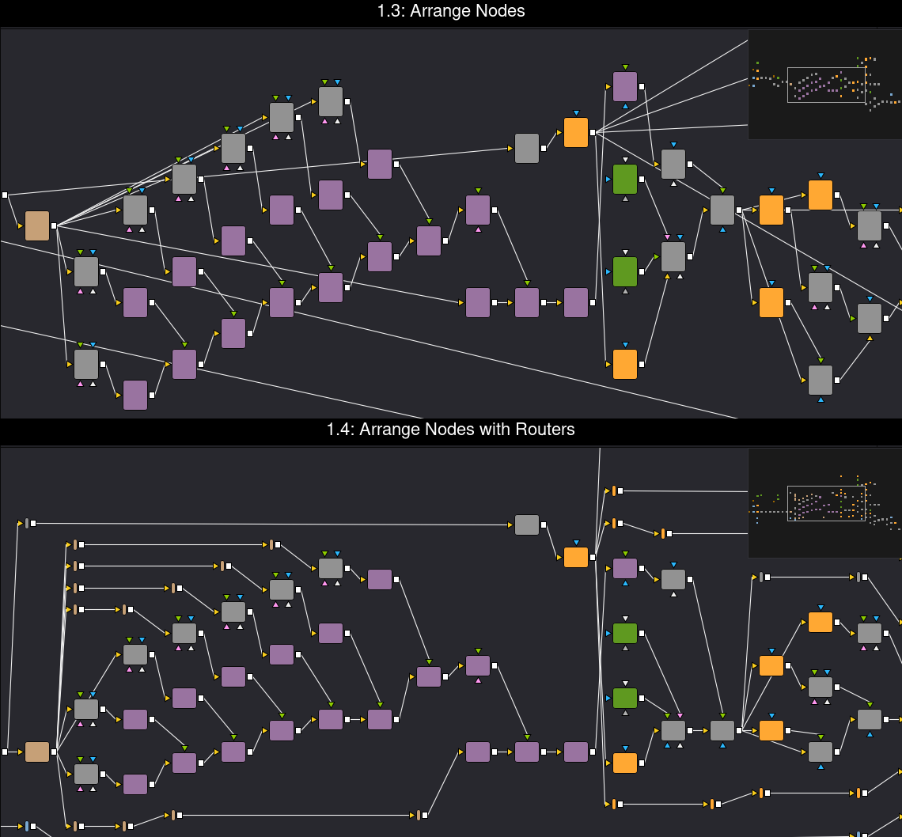

# Changelog

All notable changes to Node Arrange. Versions match `Version` in
`net.ra100.NodeArrange.atom` and the git tags.

## [1.4] - 2026-10-23

### Added

- Arrange Nodes with Routers: links that skip 3 or more columns run level
  through PipeRouters named `NARouter…`, placed in free space between tiles.
  Re-running replaces them, plain Arrange Nodes removes them, and one Undo
  reverts both. Options `routers` and `routerSpan`.

## [1.3] - 2026-10-22

### Changed

- Tools are placed level with their main input wherever their column has
  room, so the main image path is straighter. On an 81-tool comp, straight
  main links went from 15 to 24 of 69.
- Arrange Nodes (auto) picks the axis along which more links point forward.
  An arranged comp keeps its direction when you run it again.
- The Console reports crossings as Fusion draws them (straight lines).
- A tool selected inside an open Group counts as the Group. Selecting an
  Underlay selects the tools inside it.
- The swap step that moves links off tiles stops on its try budget only, so
  the result no longer depends on machine speed.

### Fixed

- Running again on a comp with Underlays no longer shifts everything each time.
- A link that loops back through a Group no longer stops the whole run. It is
  ignored for the layout, and the Console says so.
- Notes and empty Underlays inside a moved Underlay now move with it. Other
  empty Underlays are kept clear.
- An error part way through a run, such as an Underlay that cannot be
  re-created during a resize, no longer leaves the undo step open. The Console
  says what failed, and one Undo restores the comp.
- Partial option tables such as `{ horizontal = { layer = 2 } }` no longer
  cause an error.
- A selection with no tools to arrange says so in the Console.

### Added

- Before and after screenshots in the README.
- The Reactor description lists the version history and links this file.
- Offline edge-case tests: empty comp, single tool, duplicate links, `snap = 0`,
  a cycle, nested options, auto direction, Underlay re-run, an anchor inside an
  Underlay, frame margins and box obstacles.

## [1.2] - 2026-10-22

### Added

- Underlays: an Underlay and the tools inside it are arranged as one block,
  and the Underlay is resized around them with its old margins
  ([#9](https://github.com/ra100/fusion-node-arrange/issues/9)).
- A swap step moves links off tiles they would be drawn behind, without adding
  crossings. Over the test cases, links behind tiles went from 60 to 47
  ([#7](https://github.com/ra100/fusion-node-arrange/issues/7)).
- When only a selection is arranged and no tool is active, the result moves
  sideways until it covers no other tool or Underlay
  ([#10](https://github.com/ra100/fusion-node-arrange/issues/10)).
- Live tests against a running Fusion Studio. They cover Underlays, undo, and a
  non-ASCII tool name and module folder
  ([#3](https://github.com/ra100/fusion-node-arrange/issues/3)).

### Changed

- A long link's invisible placeholders sit on the straight line Fusion draws.

## [1.1] - 2026-10-22

### Changed

- The `.fu` menu actions call `RunScript("Scripts:...")`. Reactor's Deploy
  folder is already part of `Scripts:`, so the hand-written search loop is gone
  ([#1](https://github.com/ra100/fusion-node-arrange/issues/1)).
- The menu scripts load the core with `require("NodeArrange")` instead of
  `dofile` and path fallbacks
  ([#2](https://github.com/ra100/fusion-node-arrange/issues/2)).
- Tools are moved with `QueueSetPos` / `FlushSetPosQueue` inside one undo step
  ([#8](https://github.com/ra100/fusion-node-arrange/issues/8)).

### Added

- The active tool stays in place, and the layout is built around it. With one
  tool selected, that tool is the anchor
  ([#4](https://github.com/ra100/fusion-node-arrange/issues/4),
  [#5](https://github.com/ra100/fusion-node-arrange/issues/5)).
- After a run, all arranged tools are selected
  ([#6](https://github.com/ra100/fusion-node-arrange/issues/6)).
- README: how the tool is built, what is tested, and a note that the code was
  written with an AI coding assistant
  ([#11](https://github.com/ra100/fusion-node-arrange/issues/11),
  [#12](https://github.com/ra100/fusion-node-arrange/issues/12)).

## [1.0] - 2026-10-21

### Added

- First release: layered (Sugiyama) auto-layout with Arrange Nodes (auto
  direction), Arrange Nodes Horizontal and Arrange Nodes Vertical.
- Menu entries in Resolve (Workspace > Scripts > Comp > Node Arrange) and in
  the Fusion Studio menu bar.

[1.4]: https://github.com/ra100/fusion-node-arrange/compare/v1.3...v1.4
[1.3]: https://github.com/ra100/fusion-node-arrange/compare/v1.2...v1.3
[1.2]: https://github.com/ra100/fusion-node-arrange/compare/v1.1...v1.2
[1.1]: https://github.com/ra100/fusion-node-arrange/compare/v1.0...v1.1
[1.0]: https://github.com/ra100/fusion-node-arrange/releases/tag/v1.0
